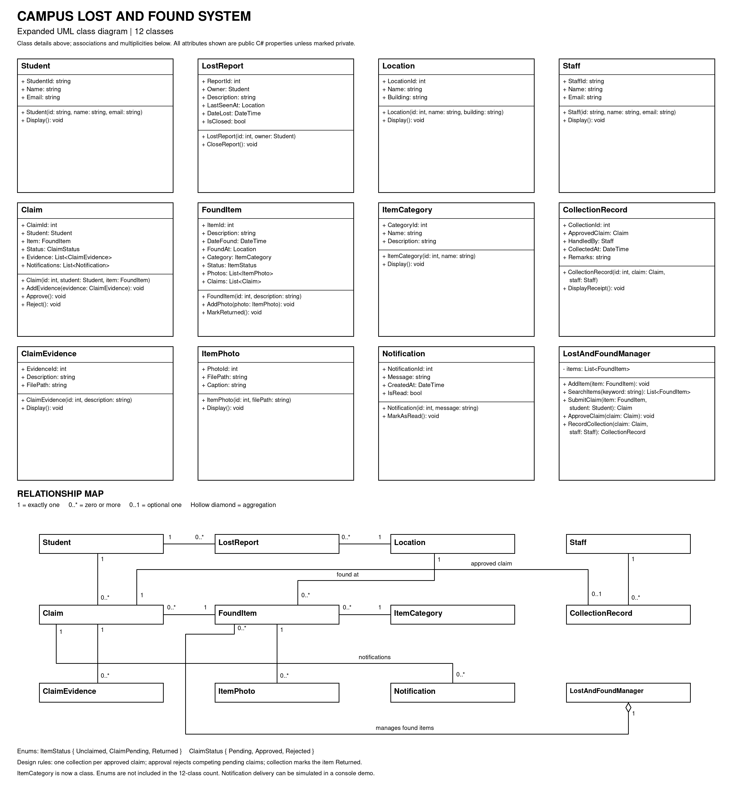

# Campus Lost and Found System

C# class library and console demonstration for an OOP group project.
The code, UML image and report in this package use the same 12-class design.

## Files

- `CampusLostAndFound.sln`: open this in Visual Studio.
- `CampusLostAndFound.Library/`: twelve classes, two enums and the library project.
- `CampusLostAndFound.Demo/`: console application and its project file.
- `docs/uml-class-diagram.png`: expanded UML class diagram (12 classes).
- `docs/Campus_Lost_and_Found_Report.docx`: matching design report.

## Classes

Student, Staff, Location, ItemCategory, LostReport, FoundItem, ItemPhoto, Claim,
ClaimEvidence, Notification, CollectionRecord and LostAndFoundManager.
Enums: ItemStatus (Unclaimed, ClaimPending, Returned) and ClaimStatus (Pending, Approved, Rejected).

## Build and run

Install the .NET 8 SDK (or a newer SDK). Run these commands from the folder containing the solution file:

```sh
dotnet build CampusLostAndFound.sln
dotnet run --project CampusLostAndFound.Demo/CampusLostAndFound.Demo.csproj
```

No external NuGet packages are required. In Visual Studio, open the solution, set the Demo
project as the startup project and run it.

## Key rules

- A found item needs a location, a category and a valid found date before the manager accepts it.
- A student cannot hold two pending claims on the same item; returned items and items with an approved claim cannot be claimed.
- Approving a claim rejects all competing pending claims; the item stays ClaimPending until collection.
- `RecordCollection` creates one CollectionRecord for an approved claim, marks the item Returned and adds a notification.
- `FoundItem.Status` is derived from its claims and from whether it has been returned.
- Notification delivery is simulated by printing messages in the demo. Data is kept in memory only.

## Demo output

Output from an actual run (dates show the day the demo is run):

```text

--- People, places and categories ---
Student S1001: Aisyah Rahman <aisyah@example.com>
Student S1002: Daniel Lim <daniel@example.com>
Staff ST01: Hafiz Karim <hafiz@example.com>
Location #1: Main Library (Library Building)
Location #2: Student Cafeteria (Block C)
Category #1: Electronics - Phones, chargers, laptops
Category #2: Clothing - Jackets, hoodies, scarves

--- Lost report ---
Report #1 by Aisyah Rahman: Black smartphone with cracked case (last seen at Main Library)

--- Search results ---
"library": 1 item(s)
"clothing": 1 item(s)
All items: 2

--- Claims ---
Phone: ClaimPending (2 claims)
Hoodie: ClaimPending (1 claim)

--- Review ---
Claim 1 (Aisyah, phone): Approved
Claim 2 (Daniel, phone): Rejected
Claim 3 (Daniel, hoodie): Rejected
Phone: ClaimPending (approved, waiting for collection)
Hoodie: Unclaimed

--- Collection ---
Receipt #1: 'Black smartphone with cracked case' collected by Aisyah Rahman, handled by Hafiz Karim on 25 Oct 2026.
Remarks: Student ID card checked.
Phone: Returned

--- Blocked actions ---
Blocked: Item has already been returned.
Blocked: Item has already been collected.
Blocked: Claim #2 is already rejected.

--- Notifications for Aisyah's claim ---
[#1] Claim #1 for 'Black smartphone with cracked case' was received and is pending review.
[#2] Claim #1 was approved. Please collect 'Black smartphone with cracked case' from staff.
[#3] 'Black smartphone with cracked case' was collected on 25 Oct 2026.
Unread: 0

--- Summary ---
Lost report #1 closed: True
Claims: 3 | Returned items: 1
```


